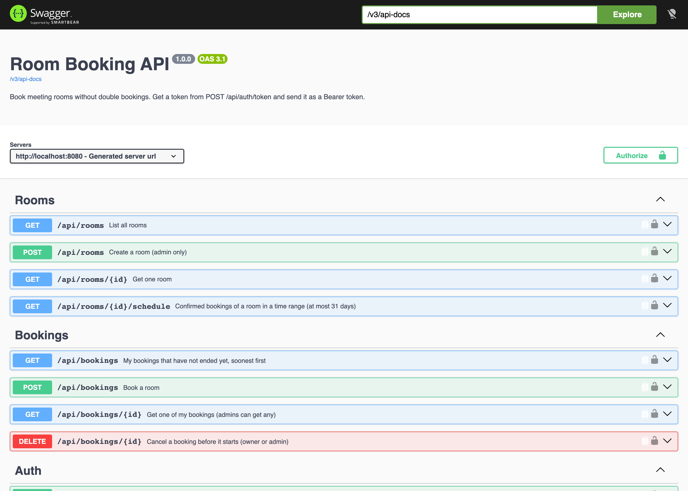

# Room Booking API

A Spring Boot REST API for booking meeting rooms, built the way I build client services: database schema in migrations, token auth with roles, consistent error responses, OpenAPI docs, Docker, and tests that run against a real PostgreSQL.

**API docs:** <https://yasinkilinc.github.io/room-booking-api/>



## The interesting part: no double bookings, even under load

Checking "is the room free?" and then inserting looks correct, but when two requests arrive at the same moment both see a free room and both insert. This service handles that in two layers:

1. **Bookings for a room are made one at a time.** The service locks the room row (`SELECT ... FOR UPDATE`) before checking for overlaps, so the check always sees committed bookings and the loser gets a clear `409` naming the booking it clashes with.
2. **The database refuses overlaps anyway.** A PostgreSQL exclusion constraint makes two confirmed bookings of the same room impossible, whatever writes to the table:

   ```sql
   CONSTRAINT booking_no_overlap EXCLUDE USING gist (
       room_id WITH =,
       tstzrange(starts_at, ends_at, '[)') WITH &&
   ) WHERE (status = 'CONFIRMED')
   ```

   `'[)'` lets back-to-back bookings (10:00-11:00 and 11:00-12:00) through, and cancelled bookings free their slot.

The first version relied on the constraint alone. The concurrency test caught a real problem with that: when 20 requests insert the same slot together, PostgreSQL sometimes resolves the conflict with **deadlocks**, so 19 users got a `500` instead of a `409`. The room lock fixed it. The test now runs 10 rounds of 20 simultaneous requests and fails on anything other than exactly one `201` and nineteen `409`s:

```text
20 simultaneous requests, responses by status: {201=1, 409=19}
```

## Features

- **Auth:** `POST /api/auth/token` exchanges username and password (bcrypt) for a JWT (HS256, 1 hour). `USER` can book and cancel their own bookings; `ADMIN` can create rooms and manage any booking. Login answers the same way for unknown users and wrong passwords.
- **Booking rules:** end after start, not in the past, at most 90 days ahead, at most 8 hours, 15-minute grid, attendees within room capacity. Limits are configuration (`booking.rules.*`), not code.
- **Errors:** every error is an [RFC 9457](https://www.rfc-editor.org/rfc/rfc9457) problem JSON, including 401 and 403 from the security layer. Validation errors list each field.
- **Idempotent cancel:** cancelling twice returns `204` both times, so clients can retry safely.
- **Paging:** `GET /api/bookings?page=0&size=20` returns a stable `{content, page, size, totalElements, totalPages}` shape; unknown sort fields are a `400`, not a `500`.
- **Schema:** Flyway migrations, Hibernate only validates. Optimistic locking (`@Version`) on bookings.

```text
$ curl -s localhost:8080/api/bookings -H "Authorization: Bearer $BOB" -H 'Content-Type: application/json' \
    -d '{"roomId":2,"title":"1:1","attendees":2,"startsAt":"2026-10-06T09:30:00Z","endsAt":"2026-10-06T10:30:00Z"}'
{"detail":"Room 'Galata' is already booked at that time","instance":"/api/bookings","status":409,
 "title":"Conflict","conflictStartsAt":"2026-10-06T09:00:00Z","conflictEndsAt":"2026-10-06T10:00:00Z",
 "conflictingBookingId":1}
```

## Run it

Requires Docker.

```bash
cp .env.example .env          # local demo secrets; use your own anywhere else
docker compose up --build
```

The API is on <http://localhost:8080>, Swagger UI on <http://localhost:8080/swagger-ui.html>. The `demo` profile creates users `alice`, `bob` (USER) and `admin` (ADMIN) with the password from `DEMO_PASSWORD`, and three rooms.

```bash
TOKEN=$(curl -s localhost:8080/api/auth/token -H 'Content-Type: application/json' \
  -d '{"username":"alice","password":"demo-password"}' | jq -r .accessToken)
curl -s localhost:8080/api/rooms -H "Authorization: Bearer $TOKEN"
```

Configuration comes from environment variables: `DB_URL`, `DB_USER`, `DB_PASSWORD`, `JWT_SECRET` (at least 32 bytes; the app refuses to start without it), `DEMO_PASSWORD`.

## Tests

Requires Java 21+ and Docker (Testcontainers starts PostgreSQL 17).

```bash
./mvnw test
```

41 tests. The API tests start the app on a random port and call it over real HTTP:

| Test class | What it proves |
| --- | --- |
| `ConcurrentBookingTest` | 10 rounds of 20 simultaneous requests for one slot: exactly one `201`, nineteen `409`, no `500`, one row in the schedule |
| `OverlapConstraintTest` | writing straight to the table with SQL, the database itself rejects an overlap (SQLSTATE `23P01`) but allows touching ranges and cancelled rows |
| `BookingApiTest` | create, conflict with the conflicting id, back-to-back, cancel frees the slot, idempotent cancel, ownership (`403`) and admin override, field errors, capacity rule, paging and sorting, room schedule |
| `AuthApiTest` | token login, same answer for wrong password and unknown user, `401` without or with a tampered token, `403` problem JSON for non-admins, case-insensitive unique room names |
| `BookingRulesTest` | each booking rule at its boundary, as a plain unit test |
| `OpenApiTest` | every endpoint and the bearer scheme are in the OpenAPI document; health is public |

## Project layout

```text
src/main/java/dev/yasinkilinc/booking/
  auth/      login, JWT encode/decode, security rules, current user
  room/      rooms, room schedule, room row lock
  booking/   booking entity, rules, service, controller
  common/    problem JSON errors, paging shape
  demo/      demo users and rooms (demo profile only)
src/main/resources/db/migration/   Flyway SQL
```

Stack: Java 21, Spring Boot 4.1, Spring Security (OAuth2 resource server), Spring Data JPA, PostgreSQL 17, Flyway, springdoc-openapi, Testcontainers, JUnit 6.
